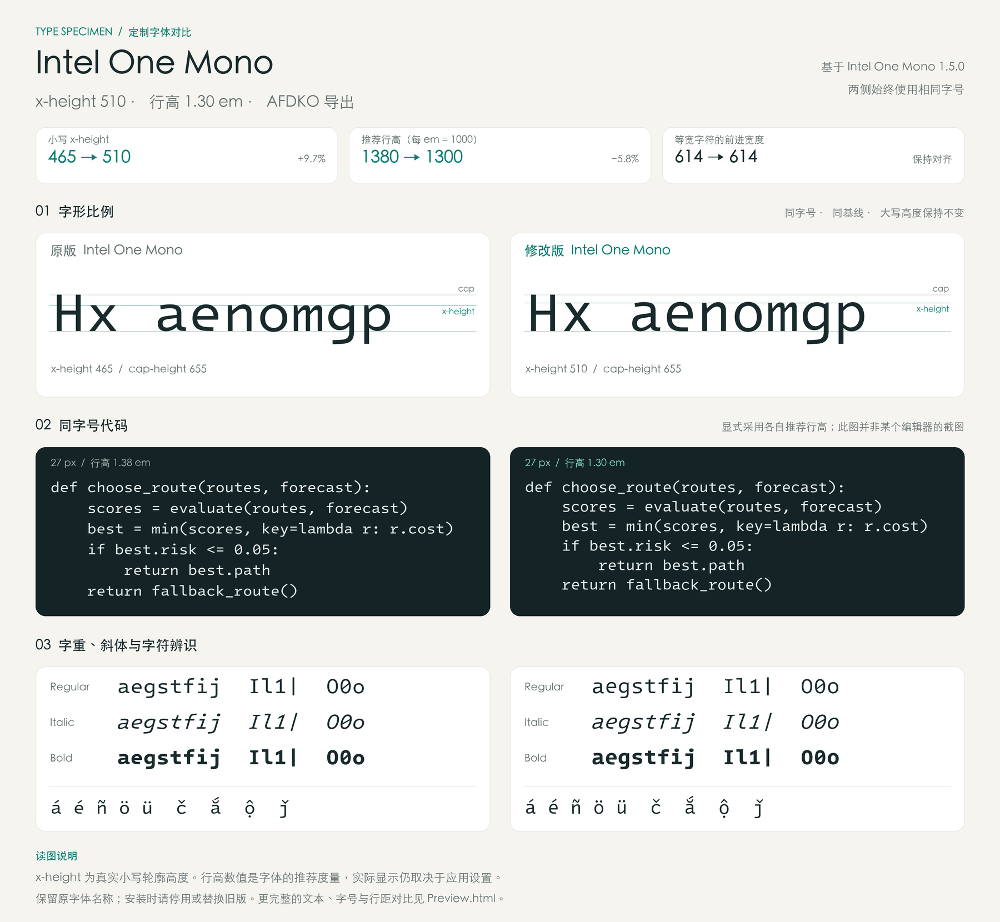

# IntelOneMono-custom

基于 [Intel One Mono 1.5.0](https://github.com/intel/intel-one-mono/releases/tag/V1.5.0) 的非官方字体修改。这个仓库提供本地构建脚本、静态对比图和验证报告，不提供字体二进制下载。

## 修改内容

- 所有样式的 x-height 增加 45 个设计单位，保留原有字重之间的差异。Regular 从 465 增至 510（UPM 1000）。
- 小写 `s` 和以它为基形的重音字母保留原版的中段粗细；大写 `S` 的轮廓不变。
- 推荐行高从 1.38 em 降至 1.30 em，框线、方块和 Powerline 字形按新行高调整。使用 Windows 度量的旧应用仍可能采用 1.50 em。
- 保留等宽字宽。使用 Adobe AFDKO 生成 8 个 TTF，以及包含全部样式的一个 TTC；输出不含 TrueType hinting。



## 本地构建

1. 从上游下载 [OTF](https://github.com/intel/intel-one-mono/releases/download/V1.5.0/intel-one-mono-otf.zip) 和 [TTF](https://github.com/intel/intel-one-mono/releases/download/V1.5.0/intel-one-mono-ttf.zip)。将原版的 8 个 `IntelOneMono-*.otf` 文件直接放到 `source-otf/`，8 个 `IntelOneMono-*.ttf` 文件直接放到 `source-ttf/`。
2. 在仓库根目录运行以下命令（Python 3.11 或更新版本）：

   ```sh
   python3 -m venv .venv
   source .venv/bin/activate
   python -m pip install -r requirements.txt
   python tools/build_font.py
   python tools/validate_fonts.py
   ```

3. 本地安装时，选择 `fonts/` 中的 TTF **或** `collection/IntelOneMono.ttc`，不要同时安装。修改版与原版使用相同的内部字体名，也不建议同时安装。

可选：运行 `python tools/make_specimen.py` 重新生成对比图和带内嵌字体的离线预览。当前构建的详细记录见 [Build-info.json](Build-info.json) 和 [Validation.json](Validation.json)；[Line-height-check.json](Line-height-check.json) 记录此前 1.504 版的行高调整。

## 许可证

原版字体作者见 [AUTHORS.txt](AUTHORS.txt)。字体软件采用 [SIL Open Font License 1.1](OFL.txt)。`Intel` 是保留字体名；保留原名的本地构建产物及内嵌字体的 HTML 预览不随本仓库分发。
